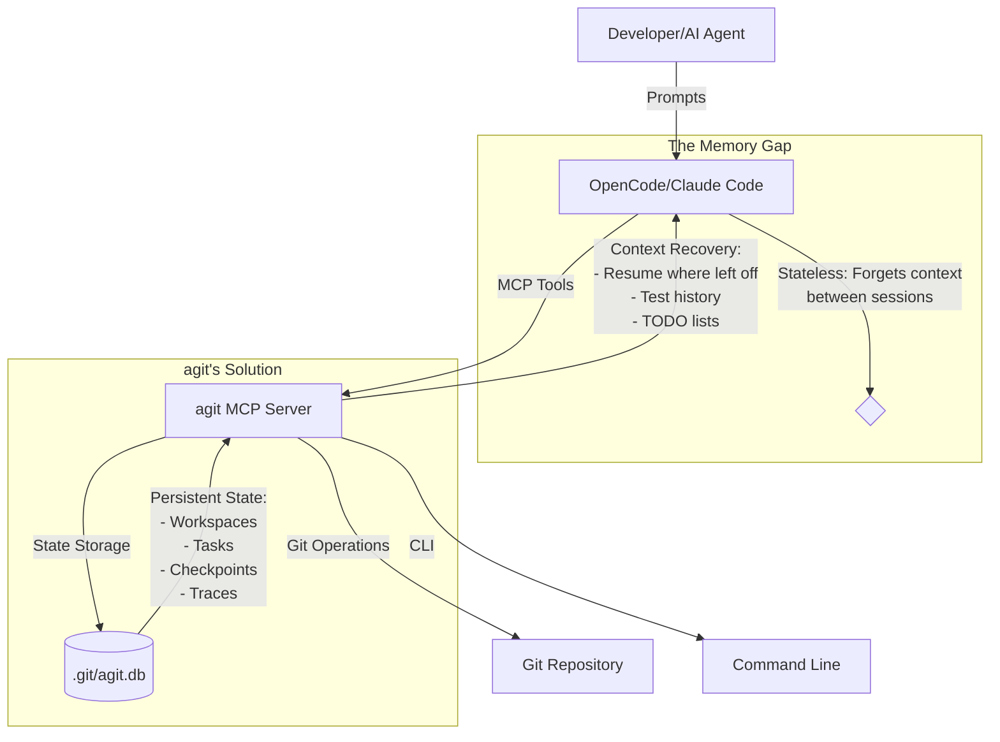
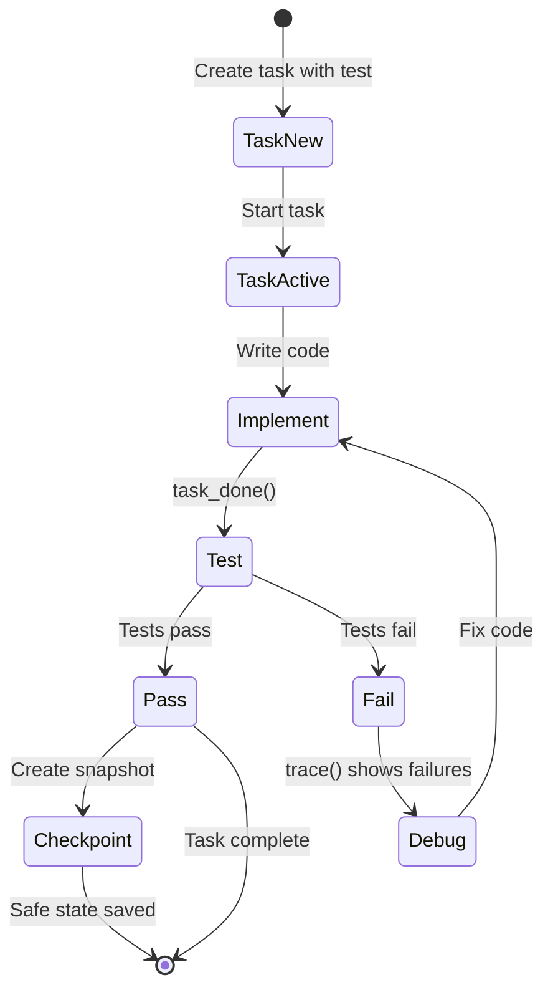
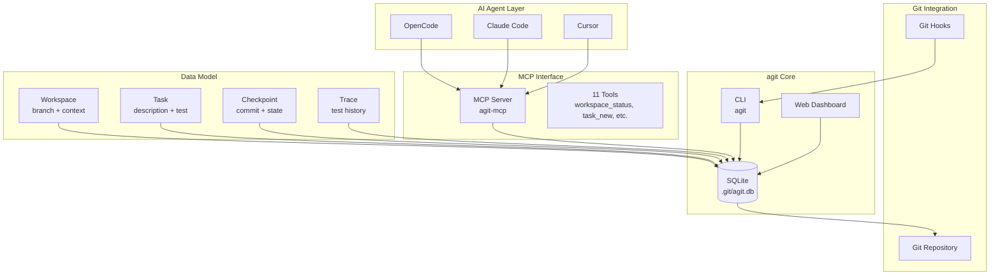
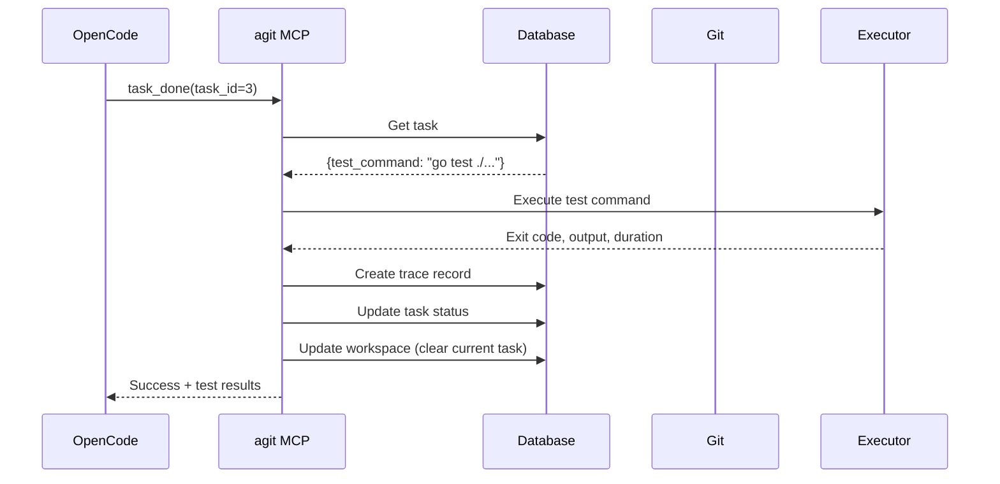
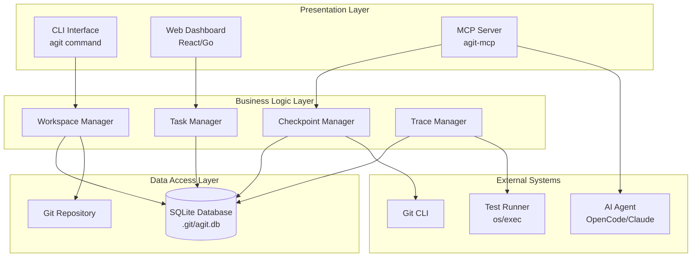
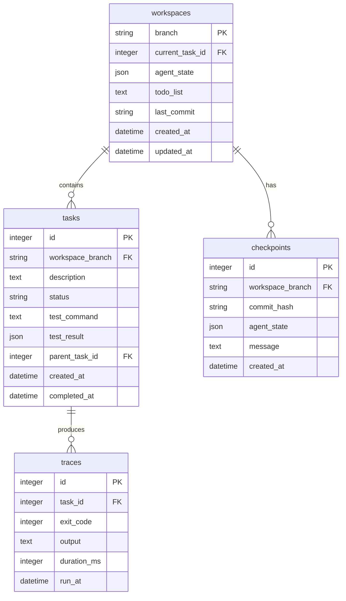
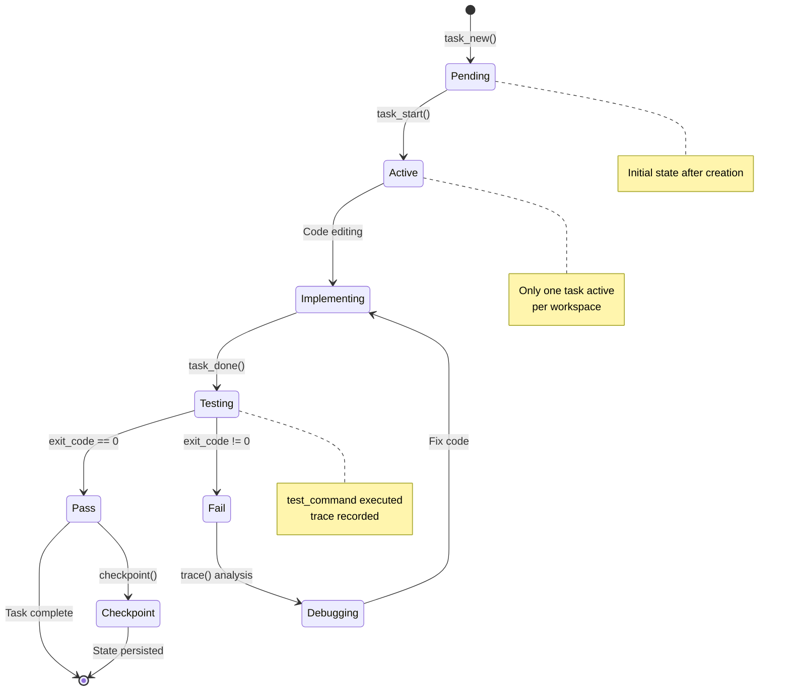
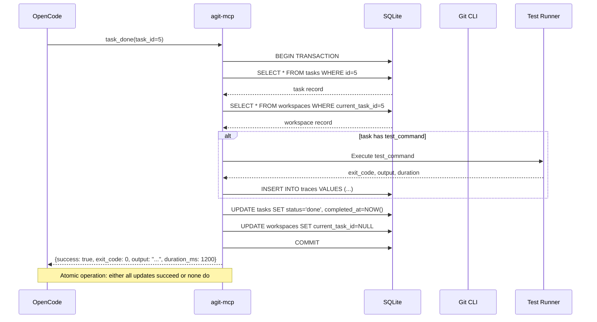
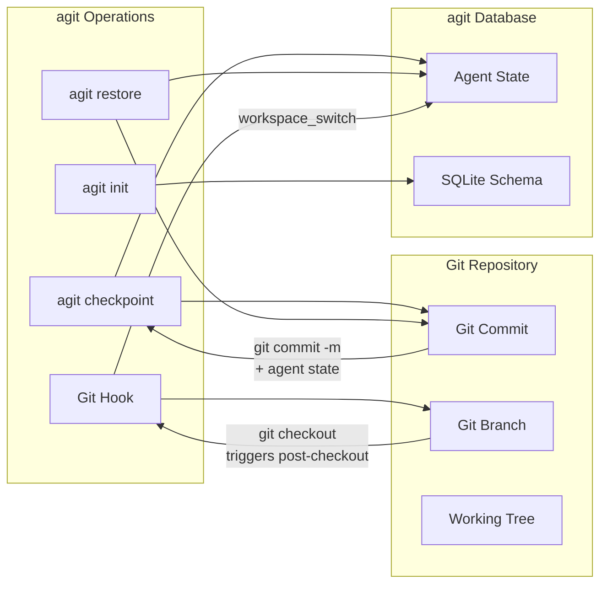

# Supercharge Your AI Workflow with agit

## The Complete Guide to Agent‑Native Development with OpenCode

*By John Soprych & Elko.AI's Dark Software Factory*  
*February 2026*

---

## 📖 Table of Contents

1. [Introduction: The AI Coding Revolution & The Memory Problem](#introduction)
2. [What is agit? The AI Workflow Machine](#what-is-agit)
3. [Installing agit & OpenCode Setup](#installation)
4. [Chapter 1: From Idea to Plan – The Project Planning Wizard](#chapter-1)
5. [Chapter 2: Seeding Your Project – Manifest & Requirements](#chapter-2)
6. [Chapter 3: First Interaction – OpenCode + agit Integration](#chapter-3)
7. [Chapter 4: The Workflow Cycle – Code, Test, Checkpoint](#chapter-4)
8. [Chapter 5: Monitoring Progress – Dashboard & Tracing](#chapter-5)
9. [Chapter 6: Advanced Patterns – Task Decomposition & Recovery](#chapter-6)
10. [Architecture Deep Dive: How agit Connects Everything](#architecture)
11. [Real‑World Example: Building a Knowledge Base API](#example)
12. [Troubleshooting & Best Practices](#troubleshooting)
13. [Conclusion: The Future of AI‑Assisted Development](#conclusion)
14. [Appendix: Technical Architecture & Data Flow Diagrams](#appendix)

---

## Introduction: The AI Coding Revolution & The Memory Problem {#introduction}

AI coding agents like **OpenCode**, **Claude Code**, and **Cursor** have transformed software development. They can write code, fix bugs, and even design architecture—but they suffer from a critical limitation:

**AI agents are stateless.**

Each session starts fresh, with no memory of:
- What you were working on yesterday
- Which tests passed or failed
- The architectural decisions you made
- The TODO list you left unfinished
- The experimental branch you were testing

This "groundhog day" effect forces developers to constantly re‑explain context, re‑run tests, and re‑establish workflow—wasting precious time and mental energy.

### The agit Solution

**agit** (Agent Git) is the **AI workflow machine** that solves this problem by providing:

1. **Git‑native state persistence** – Agent context lives alongside your code in `.git/agit.db`
2. **Test‑driven task tracking** – Every task has a test command; progress is measurable
3. **Context‑aware checkpoints** – Git commits + agent state snapshots for risk‑free experimentation
4. **MCP + CLI interfaces** – Full control via AI agents or command‑line
5. **Project‑aware workflow orchestration** – Architecture‑guided task decomposition

agit bridges the gap between Git's version control and agentic workflows, keeping AI agents **on track, informed, and productive**.

---

## What is agit? The AI Workflow Machine {#what-is-agit}



### Core Concepts

| Concept | What It Is | Why It Matters |
|---------|------------|----------------|
| **Workspace** | Current Git branch + agent context | Different features = different contexts |
| **Task** | Atomic unit of work with test command | Progress is measurable, test‑driven |
| **Checkpoint** | Git commit + agent state snapshot | Risk‑free experimentation, easy rollback |
| **Trace** | Test execution history | Debug failing tests, track quality |
| **Todo List** | Markdown checklist for current workspace | AI knows what's next |
| **Manifest** | Project configuration (`.agit‑manifest.json`) | Seeded tasks for immediate start |
| **Requirements** | Minimum standards (`.agit‑requirements.json`) | Quality, structure, workflow enforcement |

agit transforms vague AI prompts into **structured, test‑driven development workflows**.

---

## Installing agit & OpenCode Setup {#installation}

### Step 1: Install agit

```bash
# Clone the repository
git clone https://github.com/jsoprych/elko-agit.git
cd elko-agit

# Build the binaries
go build ./cmd/agit
go build ./cmd/agit-mcp

# Install globally (optional)
go install ./cmd/agit
go install ./cmd/agit-mcp
```

### Step 2: Configure OpenCode

OpenCode uses MCP (Model Context Protocol) to communicate with tools. Create `.opencode/plugins/agit.json`:

```json
{
  "name": "agit",
  "mcp": {
    "server": {
      "command": "agit-mcp",
      "args": ["--stdio"]
    }
  }
}
```

**Restart OpenCode** to load the new plugin.

### Step 3: Verify Installation

```bash
# Check agit version
agit version

# Initialize agit in your project
cd /your/project
agit init
agit hook install
```

You're now ready to supercharge your AI workflow!

---

## Chapter 1: From Idea to Plan – The Project Planning Wizard {#chapter-1}

The most critical step in AI‑driven development is **turning vague ideas into structured plans**. agit's project planning wizard conducts a conversational interview to create comprehensive project blueprints.

### The Wizard Interview

```bash
cd /projects/knowledge-base-api
agit setup
```

```
==================================================
agit Project Planning Wizard
I'll help you create a detailed project plan that agit can use to
orchestrate AI-driven development from day one.
==================================================

Project name [knowledge-base-api]: 
Brief project description (what are you building)?: 
A REST API for managing personal knowledge base entries with tags, search, and markdown support

What type of project are you building?
  1) Web Application (frontend + backend)
  2) CLI Tool / Utility
  3) Library / Package
  4) API / Microservice
  5) Data Pipeline / ETL
  6) Other
Choice (1‑6): 4

What's the primary technology stack?
  1) Go
  2) Node.js (JavaScript/TypeScript)
  3) Python
  4) Rust
  5) Other (specify test command)
Choice (1‑5): 1

What are the key features or requirements?
(Enter one per line, empty line when done)
Feature 1: RESTful CRUD operations for knowledge entries
Feature 2: Tag system with filtering and search
Feature 3: Markdown content support with rendering
Feature 4: Full‑text search across entries
Feature 5: User authentication (JWT)
Feature 6: 

Brief architecture overview (optional):
Layered architecture: handlers -> services -> repositories -> SQLite database
API Gateway pattern for future microservice expansion
```

### Task Refinement & Editing

After the initial task breakdown, the wizard presents an **interactive task editor** where you can:

- **Edit tasks** – Modify titles, descriptions, test commands, priorities, and dependencies
- **Add new tasks** – Insert additional work items
- **Delete tasks** – Remove unnecessary items
- **Reorder tasks** – Renumber IDs and update dependencies automatically
- **Validate dependencies** – Ensure task relationships are acyclic

This ensures the final project plan matches your exact requirements before any code is written.

### What the Wizard Creates

The wizard generates:
1. **Project‑aware task breakdown** – Architecture‑guided decomposition
2. **Technology‑specific defaults** – Go test commands, linters, formatters
3. **Minimum requirements** – Structure, quality, workflow, security standards
4. **Agent configurations** – MCP files for OpenCode, Claude Code, Cursor

### The Value Add

**Without agit:** You spend hours manually creating project structure, writing initial tests, and explaining context to AI agents.

**With agit:** A 5‑minute conversation produces a complete project plan that AI agents can immediately execute against.

---

## Chapter 2: Seeding Your Project – Manifest & Requirements {#chapter-2}

agit uses two configuration files to seed and govern your project:

### 1. `.agit‑manifest.json` – The Project Blueprint

```json
{
  "version": "1.0.0",
  "name": "knowledge-base-api",
  "description": "REST API for managing personal knowledge base entries with tags, search, and markdown support | Architecture: Layered architecture: handlers -> services -> repositories -> SQLite database",
  "tasks": [
    {
      "id": 1,
      "description": "Project setup and initialization",
      "test": "go test ./...",
      "dependencies": []
    },
    {
      "id": 2,
      "description": "API specification",
      "test": "go test ./...",
      "dependencies": [1]
    },
    {
      "id": 3,
      "description": "Server setup",
      "test": "go test ./...",
      "dependencies": [2]
    },
    {
      "id": 4,
      "description": "RESTful CRUD operations for knowledge entries",
      "test": "go test ./...",
      "dependencies": [3]
    }
  ],
  "agents": {
    "preferred": "opencode",
    "integrations": ["claude-code", "cursor"]
  }
}
```

### 2. `.agit‑requirements.json` – The Quality Standards

```json
{
  "version": "1.0.0",
  "structure": {
    "required_directories": ["api/", "handlers/", "middleware/", "models/"],
    "required_files": {
      "README.md": "Project documentation",
      "LICENSE": "License file",
      ".gitignore": "Git ignore patterns",
      "go.mod": "Go module definition",
      "go.sum": "Go dependencies checksum"
    }
  },
  "code_quality": {
    "linters": [
      {
        "tool": "golangci-lint",
        "command": "golangci-lint run",
        "description": "Go linter aggregator"
      }
    ],
    "formatters": [
      {
        "tool": "gofmt",
        "command": "gofmt -w .",
        "description": "Go code formatter"
      }
    ],
    "test_coverage_threshold": 80
  }
}
```

### Validating Your Setup

```bash
# Check everything is configured correctly
agit doctor

# Fix any missing components
agit doctor --fix
```

**agit fills the gap:** Without agit, quality standards are ad‑hoc and inconsistently applied. With agit, requirements are explicit, validated, and enforceable.

---

## Chapter 3: First Interaction – OpenCode + agit Integration {#chapter-3}

Now for the magic: **AI agents that remember**.

### The MCP Tool Suite

agit exposes 11 tools via MCP that OpenCode can use:

| Tool | Purpose | OpenCode Command Example |
|------|---------|--------------------------|
| `workspace_status` | Get current state | "What's my current workspace status?" |
| `task_new` | Create task | "Create a task to implement JWT authentication" |
| `task_list` | List tasks | "Show me pending tasks" |
| `task_start` | Start working | "Let's work on task #3" |
| `task_done` | Complete + test | "I'm done with task #3, run tests" |
| `checkpoint` | Save state | "Create checkpoint before refactoring" |
| `restore` | Rollback | "Restore to last checkpoint" |
| `trace` | Test history | "Show me failing tests for task #2" |
| `task_breakdown` | Decompose tasks | "Break down task #4 into subtasks" |
| `task_tree` | Hierarchical view | "Show me the task tree" |

### Example: Starting Development with OpenCode

**You:** "OpenCode, let's start building the knowledge base API."

**OpenCode:** (via agit MCP tools)
1. Checks `workspace_status` – sees no active task
2. Lists tasks with `task_list` – finds task #1 "Project setup"
3. Starts task #1 with `task_start`
4. Creates initial project structure
5. Marks task done with `task_done` – automatically runs `go test ./...`
6. Updates todo list with next steps

```json
// What OpenCode sees through agit
{
  "workspace": {
    "branch": "main",
    "current_task_id": 1,
    "todo_list": "✓ Initialize project\n• Setup Go module\n• Create basic structure\n• Write initial tests",
    "last_commit": "a1b2c3d"
  },
  "tasks": [
    {
      "id": 1,
      "description": "Project setup and initialization",
      "status": "active",
      "test_command": "go test ./..."
    }
  ]
}
```

### The Context Recovery Advantage

**Scenario:** You stop working at 5 PM. Next morning, you ask OpenCode: "What should we work on today?"

**Without agit:** "I don't know. What were you working on yesterday?"

**With agit:** "You're on task #3 'Server setup'. Yesterday you completed task #2 'API specification'. The TODO list shows: '1. Implement HTTP server 2. Add routing middleware 3. Create health endpoint'"

---

## Chapter 4: The Workflow Cycle – Code, Test, Checkpoint {#chapter-4}

agit enforces a disciplined, test‑driven workflow:



### The Checkpoint System

Checkpoints are **git commits + agent state snapshots**:

```bash
# Create a checkpoint
agit checkpoint "Implemented basic CRUD endpoints"

# What gets saved:
# 1. Git commit with message
# 2. Current workspace state (task, todo list, context)
# 3. Database schema at that moment
```

**Restoration is atomic:**
```bash
# Experiment with risky refactor
# ... something breaks ...

# Restore to last checkpoint
agit restore
# Git reset + agent state restored
```

### Example Workflow Session

```bash
# 1. Create a task
agit task new "Implement JWT middleware" --test "go test ./internal/middleware"

# 2. Start working
agit task start 5

# 3. OpenCode writes code...

# 4. Complete and test
agit task done 5
# Output: Task #5 marked as done (exit code: 0, duration: 1200 ms)

# 5. Checkpoint progress
agit checkpoint "JWT authentication implemented"

# 6. View test history
agit trace --task 5 --limit 3
```

### The Testing Discipline

Every agit task has a **test command**. When you mark a task `done`:

1. Test command executes automatically
2. Results recorded in `traces` table
3. Exit code determines success/failure
4. Output stored for debugging

This creates a **test‑driven development by default** workflow.

---

## Chapter 5: Monitoring Progress – Dashboard & Tracing {#chapter-5}

agit provides multiple ways to monitor your AI‑driven development:

### Web Dashboard

```bash
# Start the dashboard
agit dashboard
# Opens http://localhost:8080
```


**Dashboard Features:**
- **Workspace Overview** – Current branch, active task, todo list
- **Task Management** – View, filter, and manage tasks
- **Test History** – Visual trace of test executions
- **Checkpoint Browser** – Git commits + agent state
- **API Documentation** – Interactive MCP tool reference

### CLI Monitoring Tools

```bash
# View task tree
agit task tree --format tree

# Output:
├── #1 Project setup [done]
├── #2 API specification [done]
├── #3 Server setup [active]
│   ├── #5 JWT middleware [done]
│   └── #6 Rate limiting [pending]
└── #4 CRUD operations [pending]

# Check test history
agit trace --task 3 --failed-only

# Show workspace status
agit workspace-status
```

### The Trace System

Traces provide **historical debugging**:

```sql
-- agit's trace table
CREATE TABLE traces (
    task_id INTEGER,
    exit_code INTEGER,  -- 0 = success, other = failure
    output TEXT,        -- Test output (stdout + stderr)
    duration_ms INTEGER,
    run_at DATETIME
);
```

**Use case:** "Why did tests start failing yesterday?"
```bash
agit trace --task 7 --limit 10
# Shows exact test output from each run
```

---

## Chapter 6: Advanced Patterns – Task Decomposition & Recovery {#chapter-6}

### Task Decomposition

Large tasks can be broken into subtasks:

```bash
# Create parent task
agit task new "Implement search functionality" --test "go test ./internal/search"

# Break it down
agit task breakdown 8 '[{"description": "Index building", "test_command": "go test ./internal/search -run TestIndex"}, {"description": "Query parsing", "test_command": "go test ./internal/search -run TestQuery"}, {"description": "Ranking algorithm", "test_command": "go test ./internal/search -run TestRanking"}]'
```

**Result:**
```
Task #8: Implement search functionality
├── #9: Index building
├── #10: Query parsing
└── #11: Ranking algorithm
```

### Context Recovery Scenarios

#### 1. **Interrupted Work Session**
```bash
# Evening: You were working on task #9
# Morning: Check status
agit workspace-status
# Shows: "Active task: #9 Index building, TODO: Implement inverted index"

# OpenCode knows exactly where to resume
```

#### 2. **Failed Experiment**
```bash
# Create checkpoint before risky change
agit checkpoint "Before switching to new algorithm"

# Try new approach
# ... tests fail ...

# Restore
agit restore
# Back to working state with same agent context
```

#### 3. **Parallel Feature Development**
```bash
# Feature A
git checkout -b feature/search
agit task start 9  # Search implementation

# Feature B  
git checkout -b feature/auth
agit task start 5  # Authentication
# agit switches workspace context automatically
```

### The Branch‑Aware Workspace

agit's workspace system is **Git‑branch aware**:

```
Branch: main
└── Workspace: Default setup tasks

Branch: feature/search  
└── Workspace: Search‑related tasks, specific todo list

Branch: feature/auth
└── Workspace: Authentication tasks, JWT context
```

Git hooks automatically switch workspaces when you change branches.

---

## Architecture Deep Dive: How agit Connects Everything {#architecture}



### Object/Event Model

```go
// Core data structures
type Workspace struct {
    Branch         string    // Git branch
    CurrentTaskID  int64     // Active task
    TodoList       string    // Markdown checklist
    AgentState     JSON      // Serialized AI context
}

type Task struct {
    ID           int64
    Description  string
    TestCommand  string     // Command run on task_done
    Status       string     // pending/active/done/failed
    ParentTaskID int64      // For decomposition
}

type Checkpoint struct {
    CommitHash  string    // Git commit
    AgentState  JSON      // Workspace snapshot
    Message     string    // User description
}

type Trace struct {
    TaskID     int64
    ExitCode   int       // 0 = success
    Output     string    // Test stdout/stderr
    DurationMs int64
}
```

### Event Flow: `task_done` Example



---

## Real‑World Example: Building a Knowledge Base API {#example}

Let's walk through building our example project with agit and OpenCode.

### Phase 1: Project Setup

```bash
# Initialize
agit init
agit setup  # Run wizard

# Wizard creates:
# - .agit-manifest.json with 4 initial tasks
# - .agit-requirements.json with Go standards
# - MCP configs for OpenCode
# - Git hooks installed

# Verify
agit doctor
```

### Phase 2: Task Execution with OpenCode

**You:** "OpenCode, let's start building the knowledge base API."

**OpenCode interaction:**
1. Uses `workspace_status` – sees task #1 is first
2. Uses `task_start` 1 – marks it active
3. Creates `go.mod`, directory structure, initial files
4. Uses `task_done` 1 – runs `go test ./...`
5. Updates todo list with next steps

```bash
# Check progress
agit task list

# Output:
ID  Status  Description                      Created
1   done    Project setup and initialization 2026-02-20
2   active  API specification                2026-02-20
3   pending Server setup                     2026-02-20
4   pending CRUD operations                  2026-02-20
```

### Phase 3: Implementing Features

```bash
# Create checkpoint before major feature
agit checkpoint "Basic structure complete, starting CRUD implementation"

# Create specific task for note creation endpoint
agit task new "Implement POST /notes endpoint" --test "go test ./api/notes -run TestCreateNote"

# OpenCode implements the endpoint...

# Test it
agit task done 5
# Output: Task #5 marked as done (exit code: 0)

# Create another checkpoint
agit checkpoint "POST /notes endpoint implemented"
```

### Phase 4: Debugging a Failure

```bash
# Next task fails
agit task new "Implement GET /notes/:id" --test "go test ./api/notes -run TestGetNote"
agit task start 6
# OpenCode writes code...
agit task done 6
# Output: Task #6 marked as failed (exit code: 1)

# Debug
agit trace --task 6 --last 1
# Shows: "404 Not Found" error

# Fix and retry
agit task done 6  # Runs tests again
# Output: Task #6 marked as done (exit code: 0)
```

### Phase 5: Project Completion

```bash
# View overall progress
agit task tree --format tree

# Output:
├── #1 Project setup [done]
├── #2 API specification [done]
├── #3 Server setup [done]
│   ├── #5 POST /notes [done]
│   ├── #6 GET /notes/:id [done]
│   └── #7 GET /notes [done]
├── #4 CRUD operations [done]
└── #8 Search functionality [active]
    ├── #9 Index building [done]
    ├── #10 Query parsing [active]
    └── #11 Ranking algorithm [pending]

# Final checkpoint
agit checkpoint "MVP complete: Knowledge Base API v1.0"
```

---

## Troubleshooting & Best Practices {#troubleshooting}

### Common Issues

#### 1. **agit‑mcp not found**
```bash
# Solution: Build and ensure in PATH
go build ./cmd/agit-mcp
export PATH=$PATH:$(pwd)
```

#### 2. **OpenCode not recognizing agit**
```json
// Ensure .opencode/plugins/agit.json exists
{
  "name": "agit",
  "mcp": {
    "server": {
      "command": "agit-mcp",
      "args": ["--stdio"]
    }
  }
}
```

#### 3. **Tests failing intermittently**
```bash
# Check trace history
agit trace --task <id> --limit 5

# Run doctor to validate setup
agit doctor
```

### Best Practices

1. **Always use the wizard** – `agit setup` ensures complete project configuration
2. **Checkpoint before risky changes** – Create restore points for experiments
3. **Keep tasks small** – Atomic units with specific test commands
4. **Use the dashboard** – Visual monitoring prevents context loss
5. **Validate regularly** – `agit doctor` catches configuration drift
6. **Leverage task decomposition** – Break large features into testable subtasks

### Performance Tips

- **SQLite WAL mode** – agit uses Write‑Ahead Logging for concurrent access
- **Git hook efficiency** – Post‑checkout hooks are lightweight
- **State compression** – Agent state is JSON, optimized for common patterns
- **Batch operations** – MCP tools designed for minimal round‑trips

---

## Conclusion: The Future of AI‑Assisted Development {#conclusion}

agit represents a paradigm shift in how we work with AI coding agents:

### The Old Way
- 🤖 **Stateless AI** – Each session starts fresh
- 🔄 **Manual context** – Constant re‑explanation
- 📝 **Ad‑hoc testing** – Inconsistent quality
- 🗺️ **No roadmap** – Vague progress tracking

### The agit Way  
- 🧠 **Persistent state** – Context survives sessions
- 🏗️ **Structured workflow** – Test‑driven, checkpointed
- 📊 **Measurable progress** – Tasks with validation
- 🎯 **Project‑aware** – Architecture‑guided decomposition

### The Bigger Picture

agit isn't just a tool—it's a **workflow platform** that:

1. **Standardizes** AI‑human collaboration
2. **Institutionalizes** best practices (testing, documentation, structure)
3. **Scales** from solo developers to teams
4. **Adapts** to any tech stack or project type
5. **Evolves** with the AI ecosystem (new agents, new capabilities)

### Getting Started Today

1. **Install agit** – `go install github.com/jsoprych/elko-agit/cmd/agit`
2. **Run the wizard** – `agit setup` in your project
3. **Configure OpenCode** – Add the MCP plugin
4. **Start building** – Watch your AI workflow supercharge

### The Vision

In the near future, every development team will have an **AI workflow machine** like agit. It will:

- **Orchestrate** multiple AI agents on complex projects
- **Enforce** organizational standards automatically
- **Provide** real‑time project health dashboards
- **Enable** truly collaborative human‑AI development
- **Democratize** high‑quality software development

agit is the first step toward that future—a future where AI doesn't just write code, but **understands and participates in the entire development lifecycle**.

## Appendix: Technical Architecture & Data Flow Diagrams {#appendix}

This appendix provides deeper technical details about agit's architecture, data models, and flow patterns for developers who want to understand or extend the system.

### A.1 Component Architecture Layers



*Figure A.1: agit's layered architecture showing separation of concerns between presentation, business logic, data access, and external systems.*

### A.2 SQLite Database Schema (ER Diagram)



*Figure A.2: Entity‑Relationship diagram showing the four core tables and their relationships. Foreign keys enforce data integrity across workspaces, tasks, checkpoints, and traces.*

### A.3 Task State Machine



*Figure A.3: Complete state machine for tasks showing all possible transitions and the commands that trigger them.*

### A.4 MCP Tool Call Sequence (Detailed)



*Figure A.4: Detailed sequence diagram showing the atomic transaction that occurs when a task is marked done, including test execution and trace recording.*

### A.5 Git Integration Data Flow



*Figure A.5: Data flow between Git operations and agit's state management, showing how checkpoints and restores synchronize Git commits with agent state.*

### A.6 Concurrency Model & Locking

```mermaid
graph TB
    subgraph "Concurrent Access"
        Agent1[Agent 1<br/>OpenCode]
        Agent2[Agent 2<br/>Claude]
        CLI1[CLI User 1]
        CLI2[CLI User 2]
    end
    
    subgraph "Locking Layer"
        FileLock[File Lock<br/>.git/agit.lock]
        GitLock[Git Lock<br/>.git/agit.git.lock]
        PidFile[PID Tracking<br/>.git/agit.pid]
    end
    
    subgraph "Database"
        WAL[WAL Mode<br/>Write-Ahead Logging]
        Connection[Connection Pool]
    end
    
    Agent1 --> FileLock
    Agent2 --> FileLock
    CLI1 --> GitLock
    CLI2 --> GitLock
    
    FileLock --> WAL
    GitLock --> Connection
    
    style FileLock fill:#e1f5e1
    style GitLock fill:#e1f5e1
    note right of FileLock
        Exclusive lock for<br/>database writes
        Timeout: 30s
        Stale detection: 5min
    end note
```

*Figure A.6: Concurrency control mechanisms that allow multiple agents and users to interact with agit simultaneously while maintaining data consistency.*

---

## 📚 Additional Resources

- [agit GitHub Repository](https://github.com/jsoprych/elko-agit)
- [MCP Specification](https://spec.modelcontextprotocol.io/)
- [OpenCode Documentation](https://opencode.ai/docs)
- [Example Projects](https://github.com/jsoprych/agit-examples)
- [Community Forum](https://github.com/jsoprych/elko-agit/discussions)

## 🙏 Acknowledgments

This guide was created with assistance from **Elko.AI's Dark Software Factory** – an agentic development platform that builds tools for agentic development.

*agit: The AI workflow machine that keeps your AI agents on track.*

---

*© 2026 John Soprych & Elko.AI. This work is licensed under [CC BY‑NC‑SA 4.0](https://creativecommons.org/licenses/by-nc-sa/4.0/).*